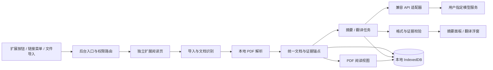

# 架构、功能与数据契约

状态：规划 v1 定稿。核心范围、详细摘要长度和三行 contributions 风格已获用户确认。目标是让相关领域学者快速确定“论文做了什么”，不扩展成科研聊天平台。

## 1. 产品边界

首版必须提供：Chrome/Firefox 扩展；独立论文阅读页；本地 PDF 或实际返回 PDF 的在线链接导入；基本 PDF 阅读；三行摘要；详细摘要；手动高亮；正文参考文献 cite 浮窗；划词/句子翻译；API 设置与本地恢复。HTML 论文页与落地页（包括 `arxiv.org/html`）不在范围内。

“任意论文”表示不依赖 Moonlight 或某个论文站的账号/接口。并不承诺恢复扫描件的文字、访问无权限全文或无损解析所有版式。遇到这些输入必须展示真实可用范围，允许继续阅读或换源。

首版不纳入问答、术语词典、独立笔记、图表解释、自动高亮、全文翻译、测验、多论文检索、推荐、云同步、用户账号。Markdown 导出列为可选，不因已有生成数据而自动扩展需求。

## 2. 技术与运行边界

建议确定为 WXT + TypeScript + React + PDF.js + IndexedDB/Dexie。Chrome 与 Firefox 均显式输出 MV3；平台差异由适配层和构建配置吸收。

- **后台**：响应工具栏/菜单、按需权限、开启/聚焦阅读页、短消息路由。不得依赖后台进程常驻承载长生成。
- **内容脚本**：仅在用户操作后采集当前网页正文、元数据和 PDF 候选链接；不持有 API 密钥，不向模型发请求，不常驻监听所有网站。
- **独立阅读页**：持有当前会话任务，负责文件导入、PDF worker、模型请求和进度；关闭阅读页意味着在途任务中断，重新打开可恢复已完成阶段并由用户重试未完成阶段。
- **解析层**：本地提取，不通过远端服务偷偷做 OCR。PDF worker 和 UI 数据处理 worker 都随扩展打包。
- **模型层**：仅发送本次任务必需的论文文本/选区；本地解析并不意味着模型推理离线。首次配置以简短说明明确发送目的地。
- **存储层**：全文、原文件、锚点、高亮、生成结果存 IndexedDB；小配置存扩展 storage.local。密钥默认只保留本次阅读器会话，可明确选择本地记住；不放 URL、日志、sync 或内容脚本消息。

“兼容 API”首版契约：用户给包含 API 前缀的 base URL（例如 `https://provider.example/v1`）、model、API key；适配器追加 `/chat/completions`，使用 Bearer 鉴权、`model/messages/stream:false` 的文本请求语义，读取非流式 `message.content`。不自动重复追加 `/v1`；本地免密端点可不发 Authorization。该契约是本项目明确支持的兼容范围，不承诺所有称作“兼容”的服务都能无适配使用。

支持能力记录 `structuredOutput / contextLimit / outputLimit`，不根据模型名称猜测；输出 token 字段等差异由 provider profile 显式声明。新安装默认使用官方 DeepSeek `/v1`、`deepseek-flash`、开启结构化输出和 32000 输出上限；已有保存配置继续生效。基础文本输出必须可工作，JSON object 是可关闭的增强；不自动重试成另一种未知协议。首版一种兼容协议，更多供应商原生协议不在范围内。模型 ID 手工填写即可，不要求端点必须实现模型列表接口。

模型请求在扩展来源页面发出，按需申请用户选择端点的 host permission；公开 HTTPS 为默认，用户显式填写 localhost/127.0.0.1 时可支持本地 HTTP。错误页区分权限拒绝、网络、鉴权、模型不存在、上下文过长、限流和返回格式错误。

## 3. 入口与导入

| 输入 | 流程 | 降级 |
|---|---|---|
| 本地 PDF | 阅读页文件选择/拖放 → 校验签名及大小 → 本地保存 → 解析 | 密码交互；损坏文件错误；无文本仍可阅读但禁用基于全文的摘要 |
| 在线 PDF | 当前标签 URL 或链接右键 → 申请来源权限 → 阅读页下载 → 校验实际内容 | HTML 登录页不得当 PDF；下载失败提示本地文件导入，不承诺使用网站登录态成功 |
| 浏览器内建 PDF 页面 | 利用当前 tab URL 尝试在独立阅读页重新获取 | 不注入系统 PDF viewer；file/blob URL 不可取时让用户选择原文件 |

在线入口只接受实际返回 PDF 的内容；HTML、摘要页与网页端论文阅读器一律显示非 PDF 输入错误，不做 DOM 采集、网页快照或 PDF 候选自动发现。

大文件使用初始限制 100 MiB 或 500 页（工程默认，可按 profiling 下调并记录）；超限在发模型前提示。文本分批抽取，不一次渲染全部页面。PDF 密码只在内存保留。

## 4. 文档结构与定位契约

| 对象 | 必需字段/语义 |
|---|---|
| Document | id、sourceType、sourceURL?、title/authors/year/doi/arxivId?、contentHash、version、originalBlobId?、extractionVersion、coverage、createdAt |
| Coverage | `full-text / partial / abstract-only / unreadable`；各章节可用性、缺页/抽取警告；另记实际送入模型的块/章节集合；由应用计算，模型不可自行升级 |
| Block | 稳定 blockId、文档版本、pageIndex?、sectionPath、type、rawText、normalizedText、raw↔normalized offset 映射、readingOrder、anchor、quality flags |
| Anchor | PDF：零基 pageIndex + PDF 原坐标矩形组 + 原文 quote。显示页码为 pageIndex+1，不混用印刷页码 |
| Reference | refId、原始书目文本、title/authors/year/doi/url 可空、目标锚点、解析依据与匹配状态；缺失字段不得补造 |
| CitationOccurrence | occurrenceId、出现位置、显示标记、refIds[]、PDF destination?、matched/ambiguous/unresolved |
| Highlight | id、docVersion、anchor(s)、颜色、quote、createdAt；与 AI 证据高亮分开 |
| Evidence | evidenceId、blockId、quote、offsets、定位精度 `exact/paragraph/page`；页面与坐标由应用派生 |
| Generation | id、kind、docVersion、inputHash、modelConfigFingerprint（不含密钥）、promptVersion、optionsHash、状态、结构化结果、evidenceIds、coverage |
| Job | jobId、阶段、完成块、attempt、运行页会话、错误；持久化检查点；不保存鉴权请求头 |

PDF 原始文本项的顺序不必等于双栏阅读顺序。解析必须重建行/段/列、分离重复页眉页脚，保留原坐标和断词映射；表格/公式不能可靠恢复时标记不可靠，不将打乱的数值送入摘要当证据。

至少区分 Abstract、Introduction、Methods、Experiments/Results、Discussion/Limitations、Conclusion、References、Appendix。标题未知时保持 Unknown，不硬套分类。理论/综述/定性论文沿用语义槽位，实验字段“不适用”而非“作者遗漏”。

缓存键由文档内容版本、抽取版本、提示词版本、模型/端点标识、语言与选项共同决定。正文 hash 变化必须重新校验。手动重生成保留上个成功版本，新版成功后切换。

## 5. 阅读与布局

默认“左侧目录—中央原文—右侧摘要”。目录可收起；摘要面板可拖拽调整宽度、收起；窄屏改为原文/摘要切换，保留位置。三行摘要默认完整显示，不为了外观裁掉关键内容。

基础 PDF 功能：滚动分页、页码跳转、上一/下一页、适合宽度/页面、缩放、旋转、目录、缩略图、全文查找及上/下匹配、文字选择与复制、原 PDF 内外链接、阅读位置恢复。打印、手写、图章、编辑 PDF 不是基础验收要求。

目录优先读取 PDF outline；没有时使用已识别章节生成并标注“自动识别”，无法识别则保留缩略图与页码。全文检索从所有页的提取文本查找，不只检索已挂载 DOM。

首屏可在全文解析前阅读；摘要面板显示“已解析 x/y 页”和章节覆盖。默认不自动发 AI 请求；按“生成论文概览”执行，先完成三行摘要，再详细摘要。已有缓存直接展示，用户可分别重生成或取消。

结果显示：三行摘要在上，采用三条贡献而非背景/方法/结果固定槽位；详细摘要按结构展开，承担完整问题与动机说明。证据 chip 紧随相关句/条目，点击跳转并临时框亮原文，支持返回原阅读位置。页面级证据明确显示“定位到页”，不能假装逐字高亮。

## 6. 高亮

选中文字 → 浮动工具条（高亮、翻译、复制）；高亮默认黄色，可选另外 3 色。点击已有高亮可换色/删除。支持跨行/跨页选择；缩放、旋转、重开后位置一致。高亮简单列表可按页跳转，不引入笔记管理或自动分类。

坐标持久化使用 PDF 原坐标，不保存屏幕像素。选区操作捕获稳定文本和 anchor，浮窗获得焦点后不能丢失原选区。摘要临时证据框不写入用户高亮。

## 7. 正文 cite 浮窗（用户已确认本地方案）

点击正文论文引用标记，打开锚定浮窗，不先跳到文末。显示原始引用条目、可提取标题/作者/年份、DOI/原文链接；仅当本地已有可信关联摘要时显示摘要。不得自动联网补全或生成被引论文摘要。

匹配优先级：PDF link annotation 的 named/explicit destination → 文末对应参考文献块 → 无链接时编号/作者年份规则。编号区间如 `[3–5]` 和多篇 `(Smith, 2020; Li, 2021)` 显示列表。destination 命中段落不等于完整书目已解析，应展示对应原文片段并保留不确定性。

没有明确 destination 的 PDF 引用识别是独立解析能力，不能从 PDF.js 直接获得完整映射。作者同姓同年、重复编号等出现歧义时显示候选；不确定时显示“未能可靠匹配”，提供文末参考文献跳转/搜索。若定位到非书目（公式/图表/章节），保持原 PDF 跳转，不错误弹论文卡。

浮窗按钮：跳到参考文献、打开 DOI/来源（新标签）、关闭；Esc/点击外部关闭，键盘可到达并返回触发点。未链接引用若成功解析可加透明 hit region；不得拦截普通正文选择。未知 DOI 不从语言模型猜测；外链允许协议限 http/https。

本地摘要匹配优先 DOI/arXiv 精确标识；只有标题近似时不得自动混用。摘要注明来源文档/版本、原始摘要或 AI 摘要及生成时间。只呈现已有结果，不因打开浮窗启动模型请求。

## 8. 划词/句子翻译

默认用户选择文本后点击“翻译”，不 hover 自动扣费。选词时翻译该词在当前句中的意思；选句/段落时忠实翻译选区，保留术语、数值、公式和引用标记。提供“扩展到整句”按钮，边界由重建文本确定；不能可靠扩句时保留原选区。

输入只含选区、前后相邻句和术语上下文，不发送全文。浮窗显示原文/译文、复制、重试、取消；不追加未经请求的讲解。默认目标中文，可切换英文；原文为中文时遵循目标语言设置。

单次最多 4000 Unicode 字符；超长提示缩小选区。缓存由文档版本、选区/上下文、语言、模型、提示词版本决定；新选区取代旧浮窗时，旧请求即便返回也不能覆盖新选区结果。

## 9. 任务与错误语义

任务状态：idle → preparing → generating → validating → success；任一阶段可 failed/cancelled/interrupted。部分合法结果可作为 draft 显示，但不能取代旧成功版本。流式 JSON 不当成最终结果直接渲染。

上下文过长时按章节分块形成证据账本再归纳，不截前 N 页伪装全文。摘要全文覆盖采用遍历所有合格正文块，问答式 top-k 检索不替代这一步。参考文献默认只做引用解析；附录在正文指向方法/结果细节时纳入并保留覆盖标记。

本地校验失败可做一次有明确错误反馈的修复请求；429 遵循 Retry-After，临时服务错误最多两次退避重试，鉴权/权限问题不反复尝试。重试范围、取消和成本状态对用户可见。并发默认至多 2 个分块任务、同文档同类生成去重；翻译不被大批处理无限饿死。

阅读页关闭/刷新后在途 job 标为 interrupted，已成功分块保留；重新进入不自动重复计费。多标签使用文档任务租约/等效单写机制防止重复请求；崩溃后租约可恢复，具体实现由 agent 选择。

## 10. 安全与适配验收约束

模型输出不可信：不允许模型自造 URL 成为 privileged 请求、校验证据 ID 属于当前文档。论文正文里的“忽略指令”等仅当内容处理。在线导入不会执行或解析返回的 HTML。

权限优先 `activeTab`、`scripting`、`storage`、`contextMenus` 与按需来源/API host permissions；不默认启用所有网页常驻注入、cookies、webRequest 或浏览历史权限。阅读器入口消息校验来源和 payload，不接受网页请求任意联网。CSP 下所有脚本/worker/字体/公式资源打包本地。

原文可在离线时打开，已缓存摘要/翻译/高亮可查看；无模型端点时 AI 按钮引导配置。缓存失败明确提示，并保留当前会话数据/文件重新导入入口，不能显示虚假的“已保存”。
